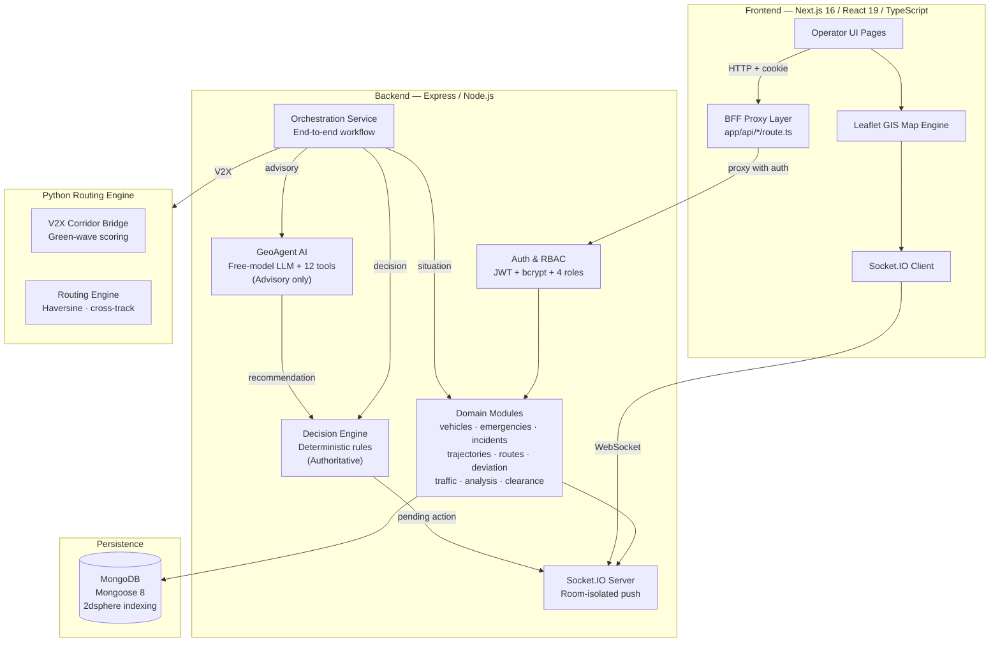

# SwiftCare GeoAgent — Emergency Response Decision-Support Platform

**Real-time geospatial monitoring, route-deviation analysis, traffic-aware insights, and AI-assisted recommendations for emergency vehicle operations.**

> ⚠️ **This is a hackathon prototype and academic project.** It has not been deployed or validated by real emergency services. The GeoAgent AI layer is advisory-only and cannot dispatch vehicles or make operational decisions. All authoritative actions require human operator approval.

**Repository**: [github.com/SwiftCareSC7/geoagent-emegency-project](https://github.com/SwiftCareSC7/geoagent-emegency-project)

**Live Demo**: Frontend → [geoagent-emegency-project-livid.vercel.app](https://geoagent-emegency-project-livid.vercel.app) · Backend → [geoagent-emergency-project.onrender.com](https://geoagent-emergency-project.onrender.com)

---

## Table of Contents

- [Overview](#overview)
- [Problem & Solution](#problem--solution)
- [Key Features](#key-features)
- [Architecture](#architecture)
- [Emergency Processing Workflow](#emergency-processing-workflow)
- [AI Safety & Decision-Making](#ai-safety--decision-making)
- [Technology Stack](#technology-stack)
- [Installation & Local Development](#installation--local-development)
- [Environment Configuration](#environment-configuration)
- [API & Real-Time Communication](#api--real-time-communication)
- [Testing & Quality Assurance](#testing--quality-assurance)
- [Deployment](#deployment)
- [Limitations & Roadmap](#limitations--roadmap)
- [Contributing](#contributing)
- [License](#license)

---

## Overview

SwiftCare GeoAgent is an emergency-response decision-support platform that monitors ambulance GPS trajectories, detects route deviations, analyzes traffic and road incidents, predicts delays, and produces structured operational recommendations for control-room operators.

The system separates **AI advisory reasoning** (GeoAgent) from **authoritative decision-making** (deterministic Decision Engine) and requires **human-in-the-loop approval** before any operational action is executed. No vehicle is dispatched, rerouted, or reassigned without an operator explicitly approving the action.

**Intended users**: Control-room dispatchers, emergency fleet administrators, ambulance drivers, and field paramedics.

**What makes this different from a basic ambulance tracker**: Rather than simply showing vehicle positions on a map, SwiftCare combines deterministic geospatial analysis (cross-track deviation, bearing divergence, ETA prediction), a Python V2X green-wave corridor engine, a bounded LLM tool-calling agent that reasons about operational situations, and a rules-based Decision Engine — all within a three-tier epistemic framework that explicitly separates observed facts, algorithmic inferences, and unknown data gaps.

---

## Problem & Solution

### Operational Challenges

Emergency vehicle response involves multiple interacting problems:

- **Route deviation detection**: Ambulances may leave their planned corridor due to road closures, driver unfamiliarity, or traffic avoidance — operators need to know when this happens and why
- **Traffic and incident analysis**: Corridor congestion and road hazards affect ETA reliability and may require rerouting
- **ETA and delay prediction**: Current navigation ETA is often inaccurate when traffic or deviation introduces delays the routing model didn't account for
- **Coordination**: Dispatchers must simultaneously monitor multiple emergencies, evaluate whether to reroute, send backup, or continue — often under time pressure

### How SwiftCare Addresses These

The platform processes GPS telemetry, planned routes, traffic data, and road incidents through a pipeline that:

1. **Detects deviations** deterministically using cross-track distance and bearing divergence from the planned route
2. **Analyzes traffic** and correlates road incidents along the response corridor
3. **Predicts ETA and delay** using a rolling EMA speed model with traffic blending and deviation penalties
4. **Produces AI advisory reasoning** via a bounded LLM tool-calling agent that can query operational tools (12 available) but cannot execute actions
5. **Evaluates decisions** through deterministic rules that produce structured actions (CONTINUE, REROUTE, CONSIDER\_BACKUP, ALERT\_CONTROL\_ROOM) with severity and reason codes
6. **Requires operator approval** before any action is executed

### Implemented vs Proposed

| Capability | Status |
|---|---|
| GPS trajectory ingestion & map-matching | ✅ Implemented |
| Route deviation detection (cross-track, bearing, GPS stability) | ✅ Implemented |
| Traffic analysis & incident correlation | ✅ Implemented |
| ETA/delay prediction (EMA model, confidence scoring) | ✅ Implemented |
| GeoAgent AI advisory (free-model LLM, 12 tools, bounded loop) | ✅ Implemented |
| Decision Engine (deterministic rules, state machine, human-in-the-loop) | ✅ Implemented |
| V2X green-wave corridor analysis (Python + JS fallback) | ✅ Implemented |
| Socket.IO real-time push (24+ events, 3 room types) | ✅ Implemented |
| Interactive Leaflet GIS map (8 basemaps, 5 layer managers) | ✅ Implemented |
| Control-room dashboard with live feeds | ✅ Implemented |
| Driver navigation cockpit (turn-by-turn HUD, 2-leg missions) | ✅ Implemented |
| Admin observability console (DB explorer, user management) | ✅ Implemented |
| What-If reroute simulator | ✅ Implemented |
| MSG91 SMS emergency status notifications | ✅ Implemented |
| Multi-call metropolitan control room overview | 🔄 Next sprint |
| Docker Compose unified environment | 📋 Planned |
| Production rate limiting on all endpoints | 📋 Planned |

---

## Key Features

### Emergency & Vehicle Monitoring
- Real-time fleet registry with lifecycle states (AVAILABLE → DISPATCHED → EN\_ROUTE → AT\_SCENE → TRANSPORTING → MAINTENANCE)
- Emergency intake with triage priority (LOW / MEDIUM / HIGH / CRITICAL)
- Vehicle assignment and dispatch tracking
- 2dsphere spatial indexing for proximity queries

### GPS Trajectory Processing
- GPS ingestion with coordinate bounds checking ([-180,180] / [-90,90]), speed validation (0–250 km/h), heading validation (0–360°)
- Teleport jitter anomaly detection (>1000m jump in 10s)
- Compound index `{ vehicle: 1, timestamp: -1 }` for efficient trajectory queries
- Bounded pagination with sanitized query guards
- 90-day TTL index on trajectory data (configurable via `TELEMETRY_RETENTION_DAYS`)

### Route Deviation Detection
- Cross-track distance calculation using Turf.js
- Bearing divergence measurement
- GPS jitter filtering with rolling stability window
- Threshold classification (STABLE / DEVIATED / CRITICAL\_DEVIATION)
- Configurable thresholds via environment variables

### Traffic & Incident Analysis
- Traffic abstraction with mock and Google Traffic providers
- Speed blending (vehicle EMA + fresh traffic data)
- Congestion ratio calculation (FREE / LIGHT / MODERATE / HEAVY / SEVERE)
- Road incident reporting and spatial correlation along corridors
- Incident proximity search (default 500m radius)

### ETA & Delay Estimation
- Rolling EMA speed model (alpha=0.4) with trend detection (DECELERATING / STABLE / ACCELERATING)
- Traffic speed blending with freshness assessment (FRESH / STALE / UNAVAILABLE)
- Historical speed benchmark (15% weight from past 20 fixes)
- Deviation penalties (DEVIATED: +120s, CRITICAL: +240s)
- V2X green-wave savings (preemptedCount × 45s)
- Delay risk classification (LOW / MEDIUM / HIGH / CRITICAL)
- Evidence-based confidence scoring (GPS density + freshness + stability + traffic source + hazard scanning)
- Route degradation state machine (hysteretic: 2 confirmations to activate/recover)

### Routing & V2X
- Provider abstraction: OSRM (default, free, OpenStreetMap), Google Routes (traffic-aware), Mock (Bengaluru corridors)
- Route calculation with alternative route generation
- Reroute from current vehicle position
- Manual route override (with required reason + audit trail)
- Content-addressed reroute candidates (SHA-256 hash verification at approval and execution)
- Python V2X corridor bridge: green-wave signal preemption scoring, civilian vehicle alerting, corridor health assessment
- JS fallback (identical spatial math) when Python unavailable

### GeoAgent AI Advisory
- Provider-agnostic LLM: OpenRouter and OpenCode (both OpenAI-compatible /chat/completions)
- **Free models only**: verified from live provider catalog (OpenRouter: every price = 0 + tool support; OpenCode: `-free` suffix)
- Bounded multi-step tool loop: max 6 rounds, 3 calls/round, 8 total calls, 8s per-tool timeout
- 12 function-calling tools with scope enforcement (emergencyId + vehicleId frozen at run start)
- Deduplication of identical tool calls (stable key hashing)
- Prompt injection defense (untrusted fields are data, never instructions)
- Strict JSON output validation
- Advisory policy: REROUTE downgraded to MONITOR if no materially better alternative verified (≥2 min savings required)
- Deterministic fallback when AI unavailable (rule-based recommendation, `fallback: true` flag)
- Model cooldown (60s per model, 10min per provider on auth failures)
- Max 4 model attempts per call across all providers

### Decision Engine
- Deterministic rules (`evaluateDecisionRules`) — pure functions, no I/O
- Actions: CONTINUE, REROUTE, CONSIDER\_BACKUP, ALERT\_CONTROL\_ROOM, NO\_ACTION
- Severity: NORMAL, WARNING, CRITICAL
- State machine: PENDING\_OPERATOR\_ACTION → APPROVED → EXECUTED (or REJECTED / CANCELLED)
- Content-addressed situation hash (SHA-256 of material operational state)
- 30-second idempotency window
- AI recommendation conflict detection (informational, never blocks approval)
- Reroute candidate integrity verification at approval and execution time

### Real-Time Communication (Socket.IO)
- JWT handshake authentication (token, Bearer header, or HTTP-only cookie)
- Per-packet account status re-validation (suspended accounts immediately disconnected)
- Room isolation: `control-room`, `emergency:{id}`, `vehicle:{id}`
- 24+ server-emitted events (all wrapped in versioned envelopes: `{ version, event, timestamp, data }`)
- Client commands for room join/leave
- React hooks: `useSocketStatus()` (connection state + reconnect detection), `useRealtimeEmergency()` (live subscriptions, freshness badges, timeline)

### Admin & Observability
- ADMIN-only RBAC
- System stats across 8 MongoDB collections
- Live database latency ping
- Upstream provider health grid (Google Routes, Google Roads, GeoAgent AI, Python/V2X, Socket.IO, MongoDB)
- Tabbed collection browser with safe projection and bounded pagination
- User management: approve/reject/suspend, role/workspace reassignment
- Prediction model performance dashboard (MAE, error distribution, ground-truth samples)

### Provider Health & Free-Model Routing
- `GET /api/health/providers` returns safe status (`AVAILABLE`, `DEGRADED`, `UNAVAILABLE`, `NOT_CONFIGURED`)
- Never exposes API keys
- GeoAgent provider health includes: provider, model, free confirmation, tool-calling verification, availability, last failure

### Deterministic Fallback Behavior
- AI provider unavailable → rule-based fallback recommendation (`fallback: true`)
- Python V2X bridge unavailable → JS fallback (identical spatial math)
- Backend unavailable (frontend) → demo fixtures with explicit `SIMULATED` labeling (never substitutes mocks in production)
- MongoDB disconnected → readiness probe returns 503
- All failure paths are non-blocking — partial results returned with explicit reason codes

---

## Architecture



### Component Responsibilities

| Component | Responsibility |
|---|---|
| **Next.js Frontend** | Operator UI, BFF proxy layer, Socket.IO client, Leaflet map engine, auth context |
| **Express Backend** | Domain modules, auth/RBAC, Socket.IO server, MongoDB persistence, provider abstractions |
| **MongoDB** | Primary datastore with 2dsphere spatial indexing, TTL on trajectories |
| **Python Routing Engine** | V2X green-wave scoring, corridor analysis (called via `spawnSync`, JS fallback) |
| **GeoAgent** | Advisory LLM tool-calling agent — analyzes situations, produces recommendations, never executes |
| **Decision Engine** | Deterministic rules engine — authoritative operational decisions, human-approved execution |
| **Orchestration Service** | Coordinates the end-to-end pipeline: validate → analyze → GeoAgent → decision → epistemic breakdown |

### Data Flow

1. GPS telemetry ingested via `POST /api/trajectories` → validates, map-matches, saves, emits `vehicle.location.updated` + `trajectory.created`
2. Throttled prediction fire-and-forget → `prediction.updated` event → triggers decision re-evaluation if route degradation sustained
3. Operator or automated trigger → `POST /api/orchestration/emergencies/:id/analyze` → sequential pipeline
4. GeoAgent runs bounded LLM tool loop → produces advisory recommendation → emits `geoagent.analysis.created`
5. Decision Engine evaluates rules → creates `PENDING_OPERATOR_ACTION` decision → emits `decision.created`
6. Operator approves → `decision.approved` → operator executes → `decision.executed` (reroute activates geometry, backup recorded)

### Error & Fallback Handling

- AI provider failures → deterministic fallback, never blocks the pipeline
- Python bridge unavailable → JS fallback (identical spatial math)
- MongoDB disconnected → `/api/health/ready` returns 503
- Backend unavailable (frontend) → demo fixtures with explicit `SIMULATED` labeling
- All orchestration stage failures are non-blocking — partial results returned with `reason` codes

---

## Emergency Processing Workflow

The verified pipeline, executed by `OrchestrationService.executeEmergencyWorkflow()`:

```
1. Resolve & validate Emergency
   → Loads emergency by ID, checks isDeleted flag
   → Returns PARTIAL if not found

2. Validate assigned Vehicle
   → Loads vehicle, checks isDeleted
   → Returns PARTIAL with reason NO_ASSIGNED_VEHICLE or ASSIGNED_VEHICLE_NOT_FOUND

3. Validate active Route
   → Finds active route for vehicle+emergency
   → Cross-module consistency check (route.vehicle === emergency.assignedVehicle)
   → Returns PARTIAL with reason NO_ACTIVE_ROUTE

4. Validate Trajectory
   → Loads latest GPS fix for vehicle
   → Returns PARTIAL with reason NO_TRAJECTORY_DATA

5. Deterministic Situation Analysis
   → analysisService.getVehicleSituation()
   → Deviation, progress, traffic, ETA/delay, correlated incidents, evidence

5b. V2X Corridor & Green-Wave Analysis
   → corridorGreenWaveService.analyzeCorridorForVehicle()
   → Python bridge (or JS fallback)
   → Signal preemption, corridor health, civilian alerts

6. GeoAgent AI Reasoning
   → geoAgentService.analyzeEmergency()
   → Bounded LLM tool loop (or deterministic fallback)
   → Advisory recommendation with confidence, evidence, uncertainty
   → Never blocks on failure (returns AI_ANALYSIS_UNAVAILABLE)

7. Decision Engine Evaluation
   → decisionService.analyzeEmergency()
   → evaluateDecisionRules() → deterministic actions, severity, reason codes
   → Creates Decision with situationHash (PENDING_OPERATOR_ACTION)
   → AI recommendation attached as advisory input

8. Build 3-Tier Epistemic Breakdown
   → OBSERVED: GPS fixes, deviation metrics, traffic, ETA, incidents, V2X status
   → INFERRED: GeoAgent likely cause, decision rule triggers
   → UNKNOWN: driver verbal confirmation, hospital ED capacity

9. Emit real-time events
   → emergency.analysis.started → emergency.analysis.completed
   → Pushed to control-room + emergency:{id} rooms

10. Return unified response
   → workflowStatus: COMPLETED | PARTIAL
   → All stages included, partial results with explicit reason codes
```

---

## AI Safety & Decision-Making

### Separation of Concerns

| Layer | Role | Authority |
|---|---|---|
| **GeoAgent AI** | Analyzes situation, produces recommendation | **Advisory only** — cannot execute actions |
| **Decision Engine** | Evaluates deterministic rules | **Authoritative** — produces the operational decision |
| **Human Operator** | Reviews and approves/rejects/executes | **Final authority** — no action without approval |

### GeoAgent Guardrails (Verified in Source)

- **Free models only**: Model called only after provider's live catalog confirms it is free (OpenRouter: every price = 0 + tool support; OpenCode: `-free` suffix). OpenRouter requests also send `provider.max_price = 0` and `require_parameters = true`.
- **Bounded tool loop**: Maximum 6 rounds, 3 calls per round, 8 total tool calls, 8s per-tool timeout. The last round offers no tools — the model must answer.
- **Duplicate call protection**: Identical tool calls (same name + args) are deduplicated via stable key hashing.
- **Tool budget exhaustion**: When the budget is reached, the model receives `TOOL_BUDGET_EXHAUSTED` and must produce the final answer.
- **Scope enforcement**: Tool execution scope (`emergencyId`, `vehicleId`) is frozen at run start. Model-supplied coordinates validated against mission anchor (max 25km offset).
- **Prompt injection defense**: Untrusted text fields (emergency descriptions, incident notes) are sanitized — HTML stripped, truncated, treated as data not instructions.
- **Advisory policy**: REROUTE is downgraded to MONITOR if no materially better alternative route is verified (≥2 min savings required). Low confidence (`< 0.5`) forces `requiresOperatorReview = true`.
- **Deterministic fallback**: When all AI providers fail, a rule-based fallback is generated with `fallback: true` and `requiresOperatorReview: true`.
- **Model cooldown**: Failed models cooled down 60s; auth failures (401/403) cool down the entire provider 10min. Max 4 model attempts per call.
- **No key exposure**: API keys never logged, never sent to the model. Health endpoint returns `AVAILABLE`/`DEGRADED`/`UNAVAILABLE`/`NOT_CONFIGURED` without keys.

### Decision Engine Safety (Verified in Source)

- **Pure deterministic rules**: `evaluateDecisionRules()` is a pure function — no database, no I/O, no AI. Given a normalized context, it produces the same output every time.
- **State machine**: `PENDING_OPERATOR_ACTION → APPROVED → EXECUTED` (or `REJECTED` / `CANCELLED`). Transitions enforced via `DECISION_TRANSITIONS` map.
- **Situation hash**: SHA-256 of material operational state. Verified at approval and execution time to detect tampering.
- **Idempotency**: 30-second window prevents duplicate decisions for the same situation.
- **AI conflict detection**: If GeoAgent's recommendation disagrees with the deterministic rules, an `AI_RECOMMENDATION_CONFLICT` reason code is attached — informational, never blocks the deterministic decision.
- **No autonomous dispatch**: `CONSIDER_BACKUP` records a recommendation but does not dispatch. `REROUTE` requires operator approval before geometry is activated.

### Limitations

- Decision thresholds (`criticalEtaMinutes: 15`, `maxAcceptableDelayMinutes: 8`, etc.) are prototype policy values, **not medically validated**. They are tunable via environment variables.
- The GeoAgent's fallback recommendation is heuristic, not learned from real emergency data.
- No real-world GPS hardware integration — telemetry is ingested via API or simulation.
- No integration with real traffic signal control systems — V2X green-wave is simulated.

---

## Technology Stack

| Technology | Responsibility | Version |
|---|---|---|
| **Next.js** | Frontend framework (App Router, BFF proxy) | 16.4.0 |
| **React** | UI library | 19.2.8 |
| **TypeScript** | Type safety (strict mode) | ^5 |
| **Tailwind CSS** | Styling | v4 |
| **Leaflet** | Interactive maps | 1.9.4 |
| **Socket.IO Client** | Real-time WebSocket client | 4.8.3 |
| **shadcn/ui** | UI primitives (Base UI + Radix) | v4 |
| **Express** | Backend HTTP server | 4.19.2 |
| **Node.js** | Backend runtime (ES Modules) | 22 (CI) |
| **MongoDB** | Primary database | 7.0 (CI) |
| **Mongoose** | ODM | 8.4.1 |
| **Socket.IO** | Real-time server | 4.8.3 |
| **@turf/turf** | Geospatial calculations | 7.4.0 |
| **Helmet** | Security headers | 7.1.0 |
| **bcryptjs** | Password hashing (12 rounds) | 3.0.3 |
| **jsonwebtoken** | JWT auth | 9.0.3 |
| **Python** | Routing & V2X engine (stdlib only) | 3.11+ |
| **Playwright** | E2E testing | 1.63.0 |
| **Gitleaks** | Secret scanning (CI) | 8.30.1 |
| **Vercel** | Frontend hosting | — |
| **Render** | Backend hosting | — |

---

## Installation & Local Development

### Prerequisites

- **Node.js** v18+ (v22 recommended — matches CI)
- **MongoDB** v6.0+ (local daemon or MongoDB Atlas free tier)
- **Python** v3.11+ (optional — for V2X routing engine; JS fallback works without it)
- **npm** (ships with Node.js)

### 1. Clone & Install

```bash
git clone https://github.com/SwiftCareSC7/geoagent-emegency-project.git
cd geoagent-emegency-project

# Frontend dependencies
npm install

# Backend dependencies
cd server
npm install
cd ..
```

### 2. Configure Backend Environment

```bash
cd server
cp .env.example .env
# Edit .env — set MONGO_URI and JWT_SECRET at minimum
cd ..
```

See [Environment Configuration](#environment-configuration) below for all variables.

### 3. Configure Frontend Environment

```bash
cp .env.example .env.local
# Edit .env.local — set NEXT_PUBLIC_API_URL and NEXT_PUBLIC_SOCKET_URL
```

### 4. Start MongoDB

```bash
# Local daemon (macOS with Homebrew)
brew services start mongodb-community

# Or use MongoDB Atlas connection string in server/.env
```

### 5. Run the Applications

```bash
# Terminal 1: Backend (port 5001 by default)
cd server
npm run dev

# Terminal 2: Frontend (port 3000)
npm run dev

# Terminal 3 (optional): Python routing demo
cd routing-engine
python demo_member2.py
```

| Service | Local URL |
|---|---|
| Frontend | http://localhost:3000 |
| Backend API | http://localhost:5001/api |
| Backend health | http://localhost:5001/api/health |
| Backend readiness | http://localhost:5001/api/health/ready |

### 6. Bootstrap Admin User

First admin must be created from a trusted shell (one-time, refuses if any admin exists):

```bash
cd server
MONGO_URI='mongodb://127.0.0.1:27017/geoagent-emergency' \
ADMIN_BOOTSTRAP_EMAIL='you@example.com' \
ADMIN_BOOTSTRAP_PASSWORD='YourPassword12!' \
node scripts/bootstrap-admin.js
```

### 7. Seed Demo Data (Optional)

```bash
# From project root
npm run seed:demo

# Or with reset
npm run seed:demo:reset
```

### 8. Canonical Demo Scenario

```bash
# Seed the demo mission
node server/seed-demo-scenario.js --clean

# Run 8-stage telemetry playback
node server/demo-telemetry-player.js --all

# With timed delay between stages
node server/demo-telemetry-player.js --all --interval 3000
```

### Troubleshooting

| Problem | Solution |
|---|---|
| `MONGO_URI` not set | Backend warns in development, refuses to start in production. Set it in `server/.env` |
| CORS error from frontend | Ensure `CLIENT_URL` in `server/.env` matches your frontend URL (default: `http://localhost:3000`) |
| Map shows "API KEY REQUIRED" watermark | Set `NEXT_PUBLIC_CARTO_API_KEY` in `.env.local` (free at [carto.com/basemaps/apikey](https://carto.com/basemaps/apikey)) |
| Socket.IO connection refused | Backend must be running. Check `NEXT_PUBLIC_SOCKET_URL` in `.env.local` |
| `tsc --noEmit` fails | Run `npm install` to ensure all type dependencies are installed |
| Backend tests fail to connect | Ensure MongoDB is running on `localhost:27017` |

---

## Environment Configuration

### Frontend (`.env.local`)

| Variable | Required | Description |
|---|---|---|
| `NEXT_PUBLIC_API_URL` | Yes | Backend API base URL (default: `http://localhost:5000/api`) |
| `NEXT_PUBLIC_SOCKET_URL` | Yes | Socket.IO server URL (default: `http://localhost:5000`) |
| `NEXT_PUBLIC_CARTO_API_KEY` | No | CARTO basemap tiles key (free, eliminates watermark) |

> **Security boundary**: Never put backend secrets (`JWT_SECRET`, `MONGO_URI`, API keys) in frontend env vars. They are exposed to the browser.

### Backend (`server/.env`)

| Variable | Required | Description |
|---|---|---|
| `PORT` | No | Backend port (default: 5001 in server.js) |
| `NODE_ENV` | No | `development` or `production` |
| `MONGO_URI` | Yes | MongoDB connection string |
| `JWT_SECRET` | Yes (prod) | Long random secret for JWT signing |
| `JWT_EXPIRES_IN` | No | Token expiry (default: 30d) |
| `CLIENT_URL` | No | Frontend URL for CORS (default: `http://localhost:3000`) |
| `ROUTING_PROVIDER` | No | `osrm` (default, free) \| `google` \| `mock` |
| `OSRM_API_URL` | No | OSRM API endpoint (default: public router) |
| `GOOGLE_MAPS_API_KEY` | No | Google Routes/Roads/Traffic |
| `TRAFFIC_PROVIDER` | No | `mock` (default) \| `google` |
| `AI_PROVIDER` | No | `auto` (default) \| `openrouter` \| `opencode` |
| `OPENROUTER_API_KEY` | No | OpenRouter API key (free models only) |
| `OPENROUTER_MODEL` | No | Preferred OpenRouter free model |
| `OPENCODE_API_KEY` | No | OpenCode API key (free models only) |
| `OPENCODE_MODEL` | No | Preferred OpenCode free model |
| `MSG91_AUTH_KEY` | No | MSG91 SMS gateway key |
| `MSG91_FLOW_ID` | No | MSG91 flow ID for emergency SMS |
| `TELEMETRY_RETENTION_DAYS` | No | Trajectory TTL (default: 90) |
| `DISABLE_RATE_LIMITS` | No | Set `true` for testing |

### GeoAgent Free-Model Configuration

```
AI_PROVIDER=auto           # tries OpenRouter first, then OpenCode
OPENROUTER_API_KEY=        # backend-only, never NEXT_PUBLIC_
OPENROUTER_MODEL=          # optional; must be a free model
OPENCODE_API_KEY=
OPENCODE_MODEL=
```

Only free models are ever called. A model is used only if the provider's live catalog confirms it is free and tool-capable. Paid models are never used — OpenRouter requests include `provider.max_price = 0` and `require_parameters = true`.

### Complete Reference

See [`server/.env.example`](server/.env.example) for all variables including deviation thresholds, decision engine thresholds, and incident proximity radius.

---

## API & Real-Time Communication

### Health Endpoints

| Method | Route | Access | Description |
|---|---|---|---|
| GET | `/api/health` | Public | Version, uptime, commit SHA |
| GET | `/api/health/live` | Public | Liveness probe (no external deps) |
| GET | `/api/health/ready` | Public | Readiness probe (checks MongoDB) |
| GET | `/api/health/providers` | Public | Provider health statuses (no keys) |

### Authentication

| Method | Route | Access | Description |
|---|---|---|---|
| POST | `/api/auth/register` | Public | Register (always PENDING, never ADMIN) |
| POST | `/api/auth/login` | Public | Login → HTTP-only cookie (7 days) |
| POST | `/api/auth/logout` | Public | Clear cookie |
| GET | `/api/auth/me` | Private | Current user |

**Example — Login:**

```bash
curl -X POST http://localhost:5001/api/auth/login \
  -H 'Content-Type: application/json' \
  -d '{"email":"operator@swiftcare.local","password":"SecurePassword123!"}' \
  -c cookies.txt
```

```json
{
  "success": true,
  "data": {
    "user": {
      "id": "...",
      "name": "Operator",
      "email": "operator@swiftcare.local",
      "role": "CONTROL_ROOM",
      "status": "APPROVED"
    }
  }
}
```

### Vehicles

| Method | Route | Access | Description |
|---|---|---|---|
| GET | `/api/vehicles` | All roles | List fleet |
| POST | `/api/vehicles` | ADMIN | Create vehicle |
| GET | `/api/vehicles/:vehicleId` | All roles + ownership | Get vehicle |
| PATCH | `/api/vehicles/:vehicleId` | All roles + ownership | Update |
| DELETE | `/api/vehicles/:vehicleId` | ADMIN | Soft delete |

### Emergencies

| Method | Route | Access | Description |
|---|---|---|---|
| GET | `/api/emergencies` | All roles | List (filter by status/priority) |
| POST | `/api/emergencies` | CONTROL_ROOM, ADMIN | Create emergency |
| GET | `/api/emergencies/:emergencyId` | All roles | Get emergency |
| PATCH | `/api/emergencies/:emergencyId` | CONTROL_ROOM, ADMIN | Update |
| DELETE | `/api/emergencies/:emergencyId` | ADMIN | Soft delete |
| PATCH | `/api/emergencies/:emergencyId/assign` | CONTROL_ROOM, ADMIN | Assign vehicle |
| GET | `/api/emergencies/:emergencyId/routes` | All roles | List routes |
| GET | `/api/emergencies/:emergencyId/decisions` | CONTROL_ROOM, ADMIN | List decisions |
| POST | `/api/emergencies/:emergencyId/send-status-sms` | All roles | Send MSG91 SMS |

### Trajectories

| Method | Route | Access | Description |
|---|---|---|---|
| POST | `/api/trajectories` | All roles + ownership | Ingest GPS point |
| GET | `/api/trajectories/:vehicleId` | All roles + ownership | Paginated history |
| GET | `/api/trajectories/:vehicleId/latest` | All roles + ownership | Latest GPS fix |
| GET | `/api/trajectories/:vehicleId/recent` | All roles + ownership | Recent points |

### Routes

| Method | Route | Access | Description |
|---|---|---|---|
| POST | `/api/routes/calculate` | Public | Calculate route plan (no DB mutation) |
| POST | `/api/routes` | All roles | Create & persist route |
| GET | `/api/routes` | All roles | List routes |
| GET | `/api/routes/:routeId` | All roles | Get route |
| GET | `/api/routes/:routeId/analysis` | CONTROL_ROOM, ADMIN | Situation analysis |
| GET | `/api/routes/:routeId/compare` | CONTROL_ROOM, ADMIN | Route comparison |
| GET | `/api/routes/:routeId/corridor-v2x` | CONTROL_ROOM, ADMIN | V2X green-wave analysis |
| POST | `/api/routes/:routeId/accept-reroute` | CONTROL_ROOM, ADMIN | Activate approved reroute |
| POST | `/api/routes/:routeId/reroute` | All roles | Recalculate from current position |
| POST | `/api/routes/:routeId/override` | CONTROL_ROOM, ADMIN | Manual geometry override |

### Analysis

| Method | Route | Access | Description |
|---|---|---|---|
| GET | `/api/analysis/vehicle/:vehicleId` | CONTROL_ROOM, ADMIN | Full situation analysis |
| GET | `/api/analysis/vehicle/:vehicleId/prediction` | CONTROL_ROOM, ADMIN | ETA & delay prediction |

### GeoAgent

| Method | Route | Access | Description |
|---|---|---|---|
| POST | `/api/geoagent/analyze` | CONTROL_ROOM, ADMIN | AI analysis for emergency |
| POST | `/api/geoagent/analyze/vehicle/:vehicleId` | CONTROL_ROOM, ADMIN | AI analysis for vehicle |

### Decisions

| Method | Route | Access | Description |
|---|---|---|---|
| POST | `/api/decisions/analyze` | CONTROL_ROOM, ADMIN | Generate decision (PENDING) |
| GET | `/api/decisions/:decisionId` | CONTROL_ROOM, ADMIN | Get decision |
| PATCH | `/api/decisions/:decisionId/approve` | CONTROL_ROOM, ADMIN | Approve (validates reroute integrity) |
| PATCH | `/api/decisions/:decisionId/reject` | CONTROL_ROOM, ADMIN | Reject (with reason) |
| PATCH/POST | `/api/decisions/:decisionId/execute` | CONTROL_ROOM, ADMIN | Execute approved decision |

### Orchestration

| Method | Route | Access | Description |
|---|---|---|---|
| POST | `/api/orchestration/emergencies/:emergencyId/analyze` | CONTROL_ROOM, ADMIN | Full end-to-end workflow |
| POST | `/api/orchestration/emergencies/:emergencyId/recommendations` | CONTROL_ROOM, ADMIN | GeoAgent task recommendations |

### Incidents, Clearance, Admin, Traffic, Deviation

| Method | Route | Access | Description |
|---|---|---|---|
| GET/POST | `/api/incidents` | All roles / All roles | List / Create incident |
| GET/PATCH/DELETE | `/api/incidents/:incidentId` | All roles / CR+AD / ADMIN | Read / Update / Delete |
| GET | `/api/deviation/vehicle/:vehicleId` | — | Deviation analysis |
| GET | `/api/traffic/location` | — | Traffic at coordinates |
| GET | `/api/clearance/vehicle/:vehicleId` | All roles | Get clearance session |
| POST | `/api/clearance/vehicle/:vehicleId/cycle` | All roles | Advance V2X cycle |
| POST | `/api/clearance/vehicle/:vehicleId/reset` | All roles | Reset clearance |
| GET | `/api/admin/stats` | ADMIN | System statistics |
| GET | `/api/admin/health` | ADMIN | Health check |
| GET | `/api/admin/users` | ADMIN | User management |
| PATCH | `/api/admin/users/:id/status` | ADMIN | Approve/suspend/reject user |

### Socket.IO Events

**Rooms:**

| Room | Description |
|---|---|
| `control-room` | All control-room and admin operators |
| `emergency:{emergencyId}` | Specific emergency channel |
| `vehicle:{vehicleId}` | Specific vehicle channel |

**Server-Emitted Events:**

All events wrapped in versioned envelope: `{ version, event, timestamp, data }`

| Event | Target Rooms |
|---|---|
| `vehicle.location.updated` | control-room + vehicle |
| `vehicle.status.updated` | control-room + vehicle |
| `trajectory.created` | control-room + vehicle |
| `emergency.created` | control-room |
| `emergency.updated` | control-room + emergency |
| `incident.created` | control-room |
| `incident.updated` | control-room |
| `route.updated` | control-room + emergency + vehicle |
| `route.deviation.detected` | control-room + emergency + vehicle |
| `traffic.updated` | control-room |
| `eta.updated` | control-room + emergency + vehicle |
| `prediction.updated` | control-room + emergency + vehicle |
| `geoagent.analysis.created` | control-room + emergency + vehicle |
| `decision.created` | control-room + emergency + vehicle |
| `decision.approved` | control-room + emergency + vehicle |
| `decision.rejected` | control-room + emergency + vehicle |
| `decision.executed` | control-room + emergency + vehicle |
| `clearance.detected` | control-room + vehicle |
| `clearance.status_updated` | control-room + vehicle |
| `clearance.cleared` | control-room + vehicle |
| `sms.submitted` / `sms.delivered` / `sms.failed` | control-room + emergency + vehicle |

**Client Commands:**

```
join.control_room / leave.control_room
join.emergency / leave.emergency
join.vehicle / leave.vehicle
room:join / room:leave   (generic with { room } payload)
```

**Example — Socket.IO Client:**

```javascript
import { io } from 'socket.io-client';

const socket = io('http://localhost:5001', {
  auth: { token },
  transports: ['websocket']
});

socket.on('connect', () => {
  socket.emit('room:join', { room: 'control-room' });
});

socket.on('route.deviation.detected', (envelope) => {
  console.log('Deviation:', envelope.data);
});
```

For the complete OpenAPI 3.0 specification (40+ endpoints), see [`docs/openapi.yaml`](docs/openapi.yaml). For Socket.IO event details, see [`docs/socket-events.md`](docs/socket-events.md).

---

## Testing & Quality Assurance

### Test Suites

| Suite | Location | Runner | Description |
|---|---|---|---|
| Auth & RBAC E2E | `e2e/auth-rbac.spec.ts` | Playwright | Role access matrix, protected routes, registration |
| Diff Simulator E2E | `e2e/diff-scenario.spec.ts` | Playwright | What-If simulator, GeoAgent output, operator approval |
| Navigation Engine | `lib/navigation/__tests__/` | Playwright | Turn-by-turn engine unit tests |
| Diff Scenario Engine | `tests/diff-scenario-engine.test.mjs` | Node test runner | 10-assertion deterministic audit |
| GeoAgent Agent Loop | `tests/geoagent-agent.test.mjs` | Node test runner | Tool loop, deduplication, fallback, injection defense |
| GeoAgent Fallback | `tests/geoagent-fallback.test.mjs` | Node test runner | Fallback response generation |
| GeoAgent Provider | `tests/geoagent-provider.test.mjs` | Node test runner | Free-model selection, provider fallback, cooldown |
| Backend Integration | `server/test-*.js` | Node | 55 test files: auth, RBAC, admin, dashboard, intelligence, security, routing |

### Commands

```bash
# TypeScript typecheck (frontend)
npm run lint          # runs: tsc --noEmit

# Frontend build
npm run build         # runs: next build

# Playwright E2E tests (requires running frontend + backend)
npm run test:e2e      # e2e/ specs
npm run test          # lib/ unit tests

# GeoAgent AI & Provider unit test suite (25/25 pass, no external server needed)
node --test tests/geoagent*.test.mjs

# Coordinate conversion & polyline safety tests (5/5 pass)
node server/test-coordinate-conversions.js

# V2X Clearance & Reroute state machine tests (100% pass)
node server/test-clearance-v2x.js

# 10-Tier Operational Intelligence Pipeline test suite (11/11 pass)
node server/test-v2x-corridor-pipeline.js

# Backend integration tests (requires running MongoDB + backend server)
cd server
node test-db-safety.js
node test-telemetry-retention.js
node test-auth-rbac-complete.js
node test-targeted-rbac-socket.js
```

### CI Pipeline

The GitHub Actions CI pipeline (`.github/workflows/ci.yml`) runs on every push and pull request:

1. **Secret scanning** (Gitleaks v8.30.1) — current checkout + git history against baseline
2. **TypeScript typecheck** (`npx tsc --noEmit`)
3. **Frontend build** (`npm run build`)
4. **Backend tests** with MongoDB 7.0 service: DB safety, telemetry retention, auth/RBAC, socket ownership, navigation engine, OSRM routing
5. **Docker build verification** (`server/Dockerfile`)

### Test Results Observed in CI Configuration

> The CI pipeline is configured to run the above suites. Actual pass/fail status depends on the runtime environment, MongoDB availability, and provider configuration. The CI configuration itself is verified and active.

---

## Deployment

### Current Deployment Architecture

| Component | Platform | Configuration |
|---|---|---|
| Frontend | Vercel | Auto-deploy on push, `next build` |
| Backend | Render | `render.yaml` — Node.js web service |
| Database | MongoDB Atlas | Managed, connection via env var |
| CI | GitHub Actions | Secret scan, typecheck, build, backend tests |

### Render Configuration (`render.yaml`)

```yaml
services:
  - type: web
    name: geoagent-backend
    runtime: node
    plan: free
    buildCommand: cd server && npm ci
    healthCheckPath: /api/health/ready
    startCommand: cd server && node server.js
```

Render auto-deploys on git push to `main`. Required env vars: `MONGO_URI`, `JWT_SECRET`, `CLIENT_URL`.

### Docker

The backend has a multi-stage Dockerfile (`server/Dockerfile`) — node:22-slim, non-root user, healthcheck on `/api/health/live`, default PORT 8080.

### Health Checks

| Endpoint | Purpose |
|---|---|
| `GET /api/health/live` | Liveness — process is alive (no external deps) |
| `GET /api/health/ready` | Readiness — MongoDB connected (returns 503 if not) |
| `GET /api/health/providers` | Provider health statuses |

### Cloud Run Template

A Google Cloud Run deployment workflow (`.github/workflows/deploy.yml`) is provided as a ready-to-use template. It is inactive by default — uncomment and configure GCP credentials to activate.

### Deployment Documentation

- [`docs/deployment.md`](docs/deployment.md) — Full deployment guide
- [`docs/deployment-checklist.md`](docs/deployment-checklist.md) — Pre-deployment checklist

---

## Limitations & Roadmap

### Known Limitations

- **Prototype thresholds**: Decision engine thresholds are not medically validated and are tunable via env vars
- **No real hardware integration**: GPS telemetry is ingested via API or simulation, not from real devices
- **V2X is simulated**: Green-wave signal preemption does not control real traffic signals
- **Free-model AI constraints**: OpenCode free tier rejects server-side calls (403 FreeTierError); OpenRouter free models have daily quotas
- **No production rate limiting on all endpoints**: Auth and AI analysis routes are rate-limited; other endpoints are not
- **No Docker Compose**: Frontend, backend, MongoDB, and Python run as separate processes
- **Single-region deployment**: No multi-region failover

### Roadmap

| Priority | Item |
|---|---|
| High | Multi-call metropolitan control room overview |
| Medium | Direct emergency intake modal from dashboard |
| Medium | Optional FastAPI wrapper for Python routing engine |
| Low | Docker Compose unified environment |
| Low | GitHub Actions CI/CD for lint, build, test, deploy |
| Low | Enterprise secrets manager integration (AWS/GCP) |
| Low | MongoDB TTL/time-series for long-term trajectory lifecycle |

---

## Contributing

### Development Workflow

1. Fork the repository
2. Create a feature branch from `main`
3. Make changes following existing patterns
4. Run `npm run lint` (typecheck) and relevant tests
5. Submit a pull request targeting `main`

### Code Conventions

- **TypeScript strict mode** for frontend
- **ES Modules** for backend (`"type": "module"`)
- Follow existing file naming and directory structure
- No secrets in code — use `.env` files (gitignored)
- Ponytail FULL methodology: smallest complete change, verify, stop

### Security & Responsible Use

- Report vulnerabilities to `security@swiftcare.local` (see [SECURITY.md](SECURITY.md))
- Never commit `.env` files, API keys, or credentials
- The Gitleaks CI scan catches accidentally committed secrets
- This is an emergency-response prototype — do not use for real emergency operations without proper validation and certification

### Bug Reports & Feature Requests

Open a GitHub issue with:
- Summary of the problem or request
- Steps to reproduce (for bugs)
- Expected vs actual behavior
- Environment details (Node.js version, OS, etc.)

---

## License

This repository does not currently declare a specific open-source license. All rights are reserved by the repository owners unless a license is added. Contact the maintainers for usage rights.

---

## Documentation Index

| Document | Description |
|---|---|
| [docs/ARCHITECTURE.md](docs/ARCHITECTURE.md) | High-level system architecture, dual-engine safety, and data flow |
| [docs/DEVELOPMENT.md](docs/DEVELOPMENT.md) | Local development setup, scripts, seeding, and troubleshooting |
| [docs/API.md](docs/API.md) | Verified REST endpoints, RBAC matrix, and Socket.IO real-time protocol |
| [docs/SECURITY.md](docs/SECURITY.md) | Secrets management, AI guardrails, db safety, and input sanitization |
| [docs/openapi.yaml](docs/openapi.yaml) | OpenAPI 3.0 specification (40+ endpoints) |
| [docs/socket-events.md](docs/socket-events.md) | Socket.IO event reference |
| [docs/database.md](docs/database.md) | Database schemas, indexes, relationships |
| [docs/environment.md](docs/environment.md) | Environment variable reference |
| [docs/deployment.md](docs/deployment.md) | Deployment guide |
| [docs/deployment-checklist.md](docs/deployment-checklist.md) | Pre-deployment checklist |
| [docs/SWIFTCARE-MASTER-TECHNICAL-REPORT.md](docs/SWIFTCARE-MASTER-TECHNICAL-REPORT.md) | Master technical report |
| [docs/SWIFTCARE-ARCHITECTURE.md](docs/SWIFTCARE-ARCHITECTURE.md) | Architecture deep-dive |
| [docs/SWIFTCARE-API-REFERENCE.md](docs/SWIFTCARE-API-REFERENCE.md) | API reference |
| [docs/SWIFTCARE-FEATURE-MATRIX.md](docs/SWIFTCARE-FEATURE-MATRIX.md) | Feature matrix |
| [SECURITY.md](SECURITY.md) | Security policy & vulnerability reporting |
| [WALKTHROUGH.md](WALKTHROUGH.md) | Technical development walkthrough |
| [routing-engine/MEMBER2_GUIDE.md](routing-engine/MEMBER2_GUIDE.md) | Python routing engine guide |

---

## Credits

Built as a hackathon project by a three-member team:

| Member | Responsibility |
|---|---|
| Member 1 | Backend core, GeoAgent AI, Decision Engine, test suites, security hardening |
| Member 2 | Python spatial routing engine, V2X green-wave scoring, telemetry simulation |
| Member 3 | Frontend UI, interactive Leaflet maps, driver navigation, control-room dashboard |
