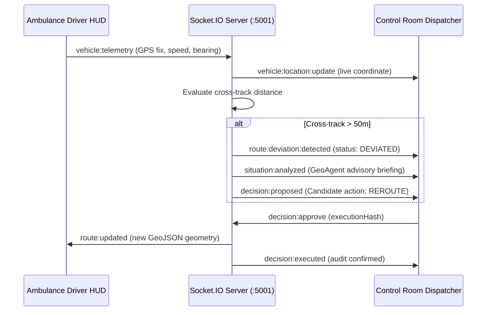

# SwiftCare GeoAgent — API & Real-Time Protocol Specification

This document provides a concise reference for the REST API endpoints and Socket.IO real-time event protocol powering the **SwiftCare GeoAgent Emergency Response System**.

For full schemas, payload examples, and OpenAPI specifications, consult:
- [docs/openapi.yaml](file:///Users/priyanshu/Documents/geoagent-emegency-project/docs/openapi.yaml) — OpenAPI 3.0 specification covering 40+ endpoints
- [docs/SWIFTCARE-API-REFERENCE.md](file:///Users/priyanshu/Documents/geoagent-emegency-project/docs/SWIFTCARE-API-REFERENCE.md) — 500-line comprehensive API reference
- [docs/socket-events.md](file:///Users/priyanshu/Documents/geoagent-emegency-project/docs/socket-events.md) — Full Socket.IO event schema reference

---

## 1. Authentication & Role-Based Access Control (RBAC)

All endpoints requiring authorization enforce either:
1. An HTTP-only secure cookie named `auth_token` containing a signed JWT, or
2. An `Authorization: Bearer <jwt>` HTTP header.

### Roles Matrix
- `ADMIN`: Global telemetry governance, user account activation, raw collection audit.
- `CONTROL_ROOM`: Emergency dispatch, route comparison review, decision candidate approval.
- `DRIVER`: Vehicle-specific telemetry broadcasting, turn-by-turn navigation HUD access.
- `PARAMEDIC`: Vital signs recording, hospital destination coordination.

---

## 2. Core REST Endpoints

### Authentication (`/api/auth`)
| Method | Endpoint | Access | Purpose |
|---|---|---|---|
| `POST` | `/api/auth/register` | Public | Register new user. Defaults to `status: PENDING` until admin approval. |
| `POST` | `/api/auth/login` | Public | Authenticates credentials, sets `auth_token` httpOnly cookie. |
| `POST` | `/api/auth/logout` | Authenticated | Clears auth cookie and terminates session. |
| `GET` | `/api/auth/me` | Authenticated | Returns current authenticated user and permitted workspaces. |

### Fleet & Vehicles (`/api/vehicles`)
| Method | Endpoint | Access | Purpose |
|---|---|---|---|
| `GET` | `/api/vehicles` | Authenticated | Lists all registered fleet ambulances with status and last GPS fix. |
| `GET` | `/api/vehicles/:id` | Authenticated | Detailed state, assigned driver, current route, and telemetry history. |
| `PATCH` | `/api/vehicles/:id/status`| `ADMIN`, `CONTROL_ROOM` | Update operational lifecycle (`AVAILABLE`, `EN_ROUTE`, `AT_SCENE`). |

### Emergencies & Dispatch (`/api/emergencies`)
| Method | Endpoint | Access | Purpose |
|---|---|---|---|
| `GET` | `/api/emergencies` | Authenticated | Lists all active and archived emergencies with triage priorities. |
| `POST` | `/api/emergencies` | `CONTROL_ROOM`, `ADMIN` | Ingests new emergency with priority, caller info, and incident coordinates. |
| `GET` | `/api/emergencies/:id` | Authenticated | Single emergency record with assigned vehicle and active corridor. |
| `POST` | `/api/emergencies/:id/assign` | `CONTROL_ROOM` | Dispatches specific vehicle to emergency. |

### Telemetry & Trajectories (`/api/trajectories`)
| Method | Endpoint | Access | Purpose |
|---|---|---|---|
| `POST` | `/api/trajectories` | `DRIVER`, `ADMIN` | Ingests live vehicle GPS fix (validated: bounds, speed, heading, jitter). |
| `GET` | `/api/trajectories/:vehicleId` | Authenticated | Retrieves recent trajectory breadcrumb points for GIS map trail. |

### Deviations & Analysis (`/api/deviations`, `/api/situations`)
| Method | Endpoint | Access | Purpose |
|---|---|---|---|
| `GET` | `/api/deviations/:vehicleId` | Authenticated | Computes cross-track distance and bearing divergence against planned route. |
| `POST` | `/api/situations/analyze` | `CONTROL_ROOM` | Triggers GeoAgent 3-tier epistemic reasoning and delay prediction. |

### Routing & What-If Rerouting (`/api/routes`)
| Method | Endpoint | Access | Purpose |
|---|---|---|---|
| `POST` | `/api/routes/calculate` | Authenticated | Computes primary corridor and alternative paths (OSRM or Google). |
| `POST` | `/api/routes/:id/reroute` | `CONTROL_ROOM` | Generates SHA-256 hashed reroute candidate avoiding congestion. |
| `POST` | `/api/routes/:id/override`| `CONTROL_ROOM` | Manual route override requiring audit justification reason. |

### Decision Engine (`/api/decisions`)
| Method | Endpoint | Access | Purpose |
|---|---|---|---|
| `GET` | `/api/decisions/:emergencyId` | `CONTROL_ROOM` | Retrieves current decision candidates and action recommendations. |
| `POST` | `/api/decisions/:id/approve` | `CONTROL_ROOM` | Dispatcher approval of candidate. Requires SHA-256 hash match. |
| `POST` | `/api/decisions/:id/reject` | `CONTROL_ROOM` | Rejection of candidate with mandatory reason code. |

### V2X Clearance (`/api/clearance`)
| Method | Endpoint | Access | Purpose |
|---|---|---|---|
| `GET` | `/api/clearance/:vehicleId` | Authenticated | Retrieves active green-wave preemption status and connected vehicles. |
| `POST` | `/api/clearance/:vehicleId/advance` | Authenticated | Advances civilian yield simulation cycle. |

### System Health (`/api/health`)
| Method | Endpoint | Access | Purpose |
|---|---|---|---|
| `GET` | `/api/health/live` | Public | Liveness probe (returns 200 OK immediately). |
| `GET` | `/api/health/ready` | Public | Readiness probe (verifies MongoDB connection). |
| `GET` | `/api/health/providers` | Public | Checks connectivity to OSRM, Google Routes, and LLM providers. |

---

## 3. Real-Time Socket.IO Protocol

Socket.IO runs concurrently on port 5001 (or via the Next.js BFF proxy).

### Room Subscriptions
- `global`: Default room for broadcast fleet events.
- `emergency:{emergencyId}`: Targeted room for emergency responders and incident commanders.
- `vehicle:{vehicleId}`: Direct downlink to the ambulance driver HUD.

### Events Reference

| Event Name | Direction | Payload Structure |
|---|---|---|
| `vehicle:location:update` | Server ➔ All | `{ vehicleId: string, coordinates: [lng, lat], speed: number, heading: number }` |
| `route:deviation:detected` | Server ➔ Dispatcher | `{ emergencyId: string, vehicleId: string, crossTrackDistance: number, status: string }` |
| `situation:analyzed` | Server ➔ Dispatcher | `{ emergencyId: string, situation: object, delaySeconds: number, confidence: number }` |
| `decision:proposed` | Server ➔ Dispatcher | `{ decisionId: string, action: string, reasonCodes: string[], candidateHash: string }` |
| `route:updated` | Server ➔ Driver | `{ emergencyId: string, route: object, steps: array }` |
| `v2x:clearance:update` | Server ➔ Driver | `{ signalsPreempted: number, vehiclesAlerted: number, clearedCount: number }` |
